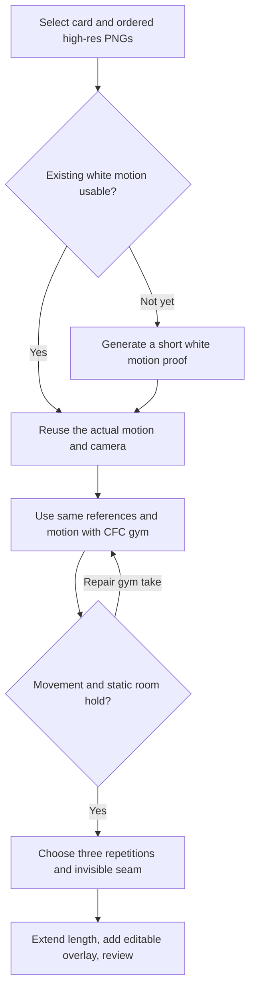

# Chart 1 photographic video workflow

The [interactive Chart 1 traveler](chart1.html) is the working station. Each exercise's Drive folder keeps one current gym prompt, the selected reference card(s), every distinct high-resolution white pose PNG, and the usable motion clips together. Retired visual candidates sit one level down in `archive`.

## The production flow

1. **Reference packet.** Use the current card(s) in visual sequence. A start or end image may repeat on a card; the individual PNG packet contains each major distinct pose. For scissor hops, keep the two marked near/far-leading cards along with the six-phase sheet, so the physical leg identity is clear.
2. **White motion proof.** Keep a working source video when it already exists. Reuse its movement, timing, apparent size and camera angle. Only generate a new proof when the video itself needs one. The scissor slot is the current example.
3. **Gym pass.** Attach the same reference photos and proven white motion when supported; change the setting to the supplied static Charles Fit Club gym. Standing moves appear nearer the camera in front of the mat; floor moves happen on the mat at a smaller fixed scale. Keep the green walls, logo and room geometry identical through the take.
4. **Video finishing.** Inspect the rendered gym video for stable identity, shoes, anatomy, orientation, camera, and background. Choose three or more good repetitions, find matching first/last poses for an unobtrusive loop, then extend to the desired workout segment. Add the HTML-rendered white-stencil exercise name/tip top-left and circular timer top-right only after the gym-integrated clip is sound.
5. **QA and handoff.** Preserve the original and the review edit. Label each as source, review/workprint or accepted; a useful asset is not automatically owner-approved. Return the gym MP4 through the traveler's handoff.

## Current Chart 1 motion readiness

| Movement | Selected visual packet | White motion | Next generation |
|---|---|---|---|
| 1 · Toe touch | Four-phase card, 3 high-res PNGs | Original Flow + 3-cycle edit usable | Gym pass; successful side-view video governs angle over front-facing stills |
| 2 · Head-only partial sit-up | Four-phase card, 3 high-res PNGs | Recovered white Mark clip, constrained 8.5-second 3-rep salvage workprint | Gym pass from head-only segment; source's later full sit-up/flip excluded |
| 3 · Alternating prone leg raise | Five-phase source-frame card, 5 high-res PNGs | Original Flow and 22.5-second review edit | Gym pass using exact source framing; verify physical leg alternation before final acceptance |
| 4 · Kneeling push-up | Four-phase card, 3 high-res PNGs | Original white Flow + 3-cycle edit usable | Gym pass on foreground mat |
| 5A · Run in place | Four-phase card, 3 high-res PNGs | White 3-cycle review usable | Gym pass standing in front of mat |
| 5B · Gentle scissor hops | Corrected six-phase card, 2 marked leading-leg cards, 6 high-res PNGs | Older bounce/run-like clip **not** a valid split-leg exchange | Generate the new **white motion proof** from the clean 00B prompt, then a gym pass |

## Prompt provenance

A prompt labeled **gym pass** is a prepared next-run prompt. It is not necessarily the verbatim text of the older successful white Flow generation. The original Flow project/video governs motion where exact historical prompt text was not saved. The successful white kneeling-push-up video-to-video wording is preserved in the exercise's recipe; its full Flow model settings remain unrecorded.

The current copyable prompts and exact media links are in the [traveler](chart1.html). The older generated art remains recoverable under the exercise's shallow `archive` folder.