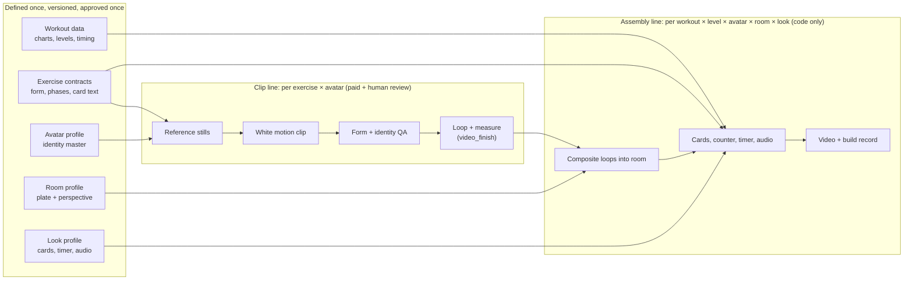
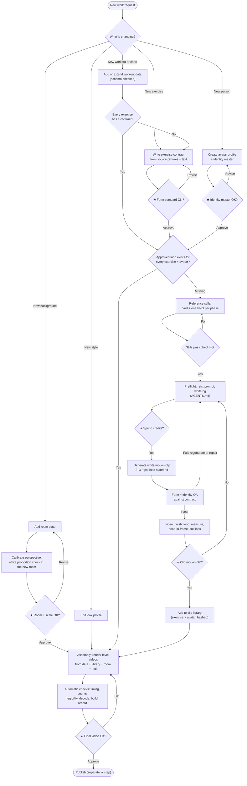

# Requirements: Reproducible workout-video production framework

Status: **Proposed**. Awaiting Charles's approval. No code, media or Drive changes come with this document.
Owner: Charles
Drafted: 2026-11-28 by Claude (overnight process review, at Charles's request)

## Why this exists

The goal of the project is a **harness that can rapidly prototype new workouts, and update old ones** with a new background or a new person doing the workout. It should not be a one-off set of Chart 1 videos.

Chart 1 has taught us most of what that harness needs, but the knowledge is spread across about 370 Markdown files, Drive notes and chat handoffs. The only flowchart (`photo-traveler/CHART1_WORKFLOW.md`) covers one chart with one boy in one room, and it still describes the retired green-wall gym pass. Nothing says, step by step, what to do when you:

- swap Mark for a different person,
- swap the studio for another room,
- move on to Chart 2, or
- build a workout that isn't 5BX at all.

This document proposes that missing framework. It reuses what already works: chart data, motion contracts, `tools/video_finish`, the traveler and the approval rules in `AGENTS.md`.

## The core idea: separate what changes from what doesn't

A finished workout video is the product of **five independent inputs**. Each one is defined once, versioned, and approved once.

| Input | What it is | Changes when… | Lives today in |
|---|---|---|---|
| **Workout** | Exercises, order, times, reps per level, interval rules (e.g. 10 scissor jumps every 75 steps) | New chart, new level, new program | `data/5bx-charts.json` |
| **Exercise contract** | Avatar-independent movement: start pose, phases, the beat that must be there, what may be relaxed, counting rule, body kind (standing / lying / kneeling), loop type (single / alternating), card text | Form decision, new exercise | Split: `photo_motion/specs/*.json`, card text typed into two renderers, form standard in a project note |
| **Avatar** | Who performs: identity master image + hash, wardrobe, shoes, age/body rules | New person | Drive image + hash quoted in `AGENTS.md` and handoffs (no file in repo) |
| **Room** | Background plate + its measured perspective (horizon, size per depth, contact lines) | New background | `tools/video_finish/config.json` (`plate`, `proportion`) |
| **Look** | Cards, ring timer, fonts, colors, brand placement, audio cues | Restyle, new brand | Two separate renderers (`video/render_white_prototype.py`, Drive `render_chart1_svg_cards.mjs`) |

Two production lines combine them:

- **Clip line (exercise × avatar):** reference stills → a short **white-background** motion clip → form QA → a clean loop. This is the expensive part (paid generation plus human review). **White-first is the key design choice:** a white clip can be dropped into any room later without generating again.
- **Assembly line (workout × level × avatar × room × look):** pure code. It reads the data, places each approved loop in the room at the right size, adds cards, counters, timer and audio, and writes the video plus a build record. It is cheap and can be rerun at any time.

## End-to-end flow with approval gates

Diamonds marked ★ are **Charles's decisions**. Everything else can be done by an agent.

## What reruns when something changes (change-impact matrix)

| Change | Redo | Reuse untouched | Paid generation? |
|---|---|---|---|
| **New level** (e.g. Chart 1 C+) | Assembly only | Everything else | No |
| **Card wording / colors / timer / audio** | Look profile → Assembly | Clips, room, data | No |
| **New background / room** | Room profile + calibration → re-composite existing white clips → Assembly | Avatar, contracts, all white clips | **No** (white-first pays off) |
| **Next chart** (e.g. Chart 2) | Contracts for exercises that differ → stills + clips for those only → Assembly | Avatar, room, look, renderer, clips for unchanged exercises | Yes, only for new or changed exercises |
| **New person** (avatar) | Avatar profile → stills + white clips for every exercise used → Assembly | Contracts, data, room, look, renderer | Yes, for each exercise |
| **New workout** (not 5BX) | Workout data file + contracts for its exercises → stills + clips → Assembly | Avatar, room, look, renderer, QA tools | Yes, for each exercise |
| **Form correction** (e.g. scissor) | Contract → that exercise's stills and clip → Assembly | Everything else | Yes, one exercise |

## Playbooks (checklists)

### A. New person doing the workout
- [ ] Write `avatars/<id>.json`: name, age band, body rules, wardrobe, shoes, forbidden traits, and the identity master's Drive ID and SHA-256.
- [ ] Generate the identity master on a white seamless background. ★ Charles approves it. Record the hash.
- [ ] For each exercise in the target workout, make reference stills (card + one PNG per phase) from the **existing contract**. Never chain identity from one generated video into another.
- [ ] Still checklist per exercise: same face, age and body; shoes intact; facing direction per contract; the "must be there" beat visible; nothing cropped; white background.
- [ ] Run the preflight, then ★ get approval to spend credits. Generate a white motion clip (2–3 reps, start and end held half a second, full body with margin).
- [ ] Run form + identity QA against the contract, then `video_finish` (measure body length → loop → composite). ★ Charles approves the clip.
- [ ] Add the clip to the library under `<exercise>×<avatar>`. Run assembly. ★ Charles approves the final video.

### B. New background or room
- [ ] Add the plate to the room profile (cleaned, no people, 16:9, wall areas behind the overlays slightly darker than white).
- [ ] Make a **white-background proportion check** in the new room: the standing, lying and kneeling figures at their intended spots, measured on white. A busy background throws off the cut-out measurement.
- [ ] Record horizon, size per depth and contact lines in the room profile. ★ Charles approves scale and placement.
- [ ] Re-composite every existing white clip with `video_finish`. Check the reports: head visible, no cut lines.
- [ ] Run assembly. No generation needed.

### C. Next chart (5BX Chart 2+)
- [ ] Data already exists in `data/5bx-charts.json`. Confirm the renderer handles that chart's interval rules.
- [ ] Diff the chart's exercises against existing contracts. Reuse where the movement is the same; write a new contract only where it differs. Use Orban's pictures for that chart, the middle-school standard, and the booklet text for counting rules.
- [ ] ★ Charles approves the form standard for the new or changed contracts.
- [ ] Follow Playbook A's clip steps for the changed exercises only. Then run assembly for all 12 levels.

### D. A new workout (not 5BX)
- [ ] Write `workouts/<id>.json` in the same schema: exercises, order, time per exercise, reps per level, interval or switch rules, counting rule, source citation.
- [ ] Write an exercise contract for each movement, with a cited source (picture or video) that decides form.
- [ ] Reuse the avatar, room and look as they are, or pick others. Follow Playbook A for the clips. Run assembly.

### E. Wording, timing or style tweak
- [ ] Change the contract's card text or the look profile. Re-run assembly. Spot-check one level on a phone in landscape.

## Gaps found in the current setup

1. **Card and overlay text is typed in two places**: `render_white_prototype.py`, and ChatGPT's `render_chart1_svg_cards.mjs` in Drive. Neither reads the exercise contracts. The two already disagree (e.g. "feet down between", "arms stay low").
2. **Durations are typed into the renderer** (120/60/60/60/360) instead of read from `data/5bx-charts.json`, which breaks the repo's own rule. No renderer handles reps, steps or levels yet.
3. **No avatar profile file for the photographic Mark.** The identity lives as a Drive ID and hash quoted in `AGENTS.md` and handoff notes. `sprites/config/character.json` describes the retired cartoon boy. Swapping avatars therefore has no single place to change.
4. **Room calibration is buried in `tools/video_finish/config.json`**, next to per-clip data. A second room would mean editing the same block, so the old room's numbers would be lost.
5. **Contracts and the current form standard disagree.** `photo_motion/specs/chart1-partial-situp.json` still says "only far enough to see heels". The 2026-11-27 middle-school standard (Orban's pictures decide) isn't in any contract.
6. **The Drive layout is organized by chart** (`00_CHART_1_CURRENT__OPEN_THIS/<exercise>`), not by avatar or room, so a second avatar has no obvious home.
7. **Process knowledge is buried.** About 30 one-off experiment documents sit in `photo_motion/` (V6–V15 preflights, etc.) next to the few that describe the current process. A newcomer, human or agent, can't tell which is current.
8. **The only flowchart is stale.** `photo-traveler/CHART1_WORKFLOW.md` still describes the green-wall "gym pass" generation. That has been replaced by white-first + `video_finish`.

## Requirements

### R1. One definition per input
1. THE SYSTEM SHALL keep exactly one versioned definition each for: workout data, exercise contract, avatar profile, room profile and look profile.
2. Card titles, tips, form cues and counting rules SHALL come from the exercise contract. No renderer SHALL contain exercise wording.
3. Times, reps, steps and interval rules SHALL come only from the workout data file.

### R2. White-first clip library
1. Every approved motion clip SHALL be a white-background source plus loop settings and a measured body length, keyed by `exercise × avatar`, with Drive ID, SHA-256 and approval record.
2. A clip SHALL be reusable in any approved room without regeneration.
3. A missing clip SHALL be reported by name. Assembly SHALL NOT substitute another exercise or avatar.

### R3. Assembly is code-only and reproducible
1. One command SHALL render any `workout × level × avatar × room × look` combination.
2. Each render SHALL write a build record: input versions and hashes, code revision, output hash.
3. Re-running with the same inputs SHALL produce the same video.

### R4. Change only what changed
1. Changing the room or the look SHALL NOT require generating any new clip.
2. Adding an avatar SHALL NOT require editing workout data, contracts, rooms or the renderer.
3. Adding a workout SHALL NOT require code changes when its rules fit the schema.

### R5. Gates stay with Charles
1. Identity masters, form standards, credit spending, each clip's motion, each final video and publishing remain Charles's decisions, as in `AGENTS.md`.
2. Automatic checks SHALL be reported as evidence, never as approval.

### R6. One current process document
1. A single `PROCESS.md` (this framework's design, once approved) SHALL be the entry point, linked from `CLAUDE.md`, `AGENTS.md` and the Drive traveler.
2. Superseded experiment docs SHALL move under an `archive/` folder with a one-line index, so the current path is obvious.

## Proposed rollout (after approval; each step is a small PR)

1. Add `avatars/mark-v2.json` and `rooms/studio-two-dumbbells.json`, moving the room block out of `video_finish/config.json` with identical numbers. Add a schema and tests.
2. Add card text and the middle-school form standard to the Chart 1 contracts. Fix the sit-up "see heels" wording.
3. Build the per-level renderer: data-driven, reads contracts and the clip library, rep/step counter, scissor sets every 75 steps.
4. Make the look profile a single source for cards and timer. Retire the two hand-typed renderers.
5. Write `PROCESS.md` with the diagrams above. Move experiment docs to `archive/`. Update the traveler.
6. Pilot the framework on **one non-default change** to prove it: re-render Chart 1 in a second room with no new generation (cheapest), then a second avatar on two exercises (knee push-up + scissor), as `specs/sprite-production-line` already proposed for the cartoon line.

## Open questions for Charles

1. Is a non-5BX workout realistic soon? If yes, `workouts/` should be a schema from day one; if not, keep `data/5bx-charts.json` and generalize later.
2. Should Drive move to `avatar/room` folders (e.g. `Clips/mark-v2/c1-ex4/`), or stay organized by chart, with the avatar in each file name?
3. Is the second-room pilot (no credits) a good first proof, before any second avatar?
